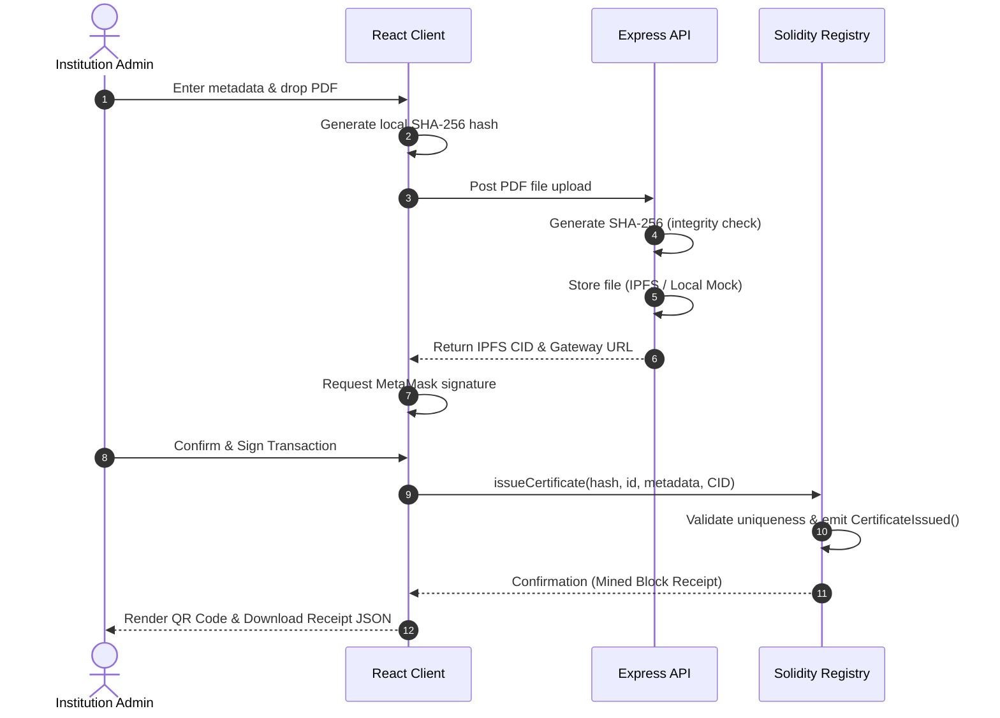

# Project Report: Blockchain-Based Certificate Verification System (VeriChain)

**Author:** [Shubham G. Madaye]  
**Topic:** Decentralized Trust & Document Verification using Blockchain and IPFS  
**Target Audience:** Recruiters, Professors, and System Architects  

---

## 1. Executive Summary

Traditional certificate verification is heavily centralized, slow, and prone to forgery. Educational institutions maintain private databases that employers must trust, resulting in manual verification bottlenecks. 

**VeriChain** is a full-stack decentralized application (dApp) that solves this problem. It allows institutions to issue tamper-proof digital certificates. By separating storage from validation:
- The actual certificate PDF is stored in **IPFS (decentralized storage)** to keep blockchain gas costs low.
- The document's **SHA-256 cryptographic signature** and metadata are recorded on the **Ethereum blockchain**.
- Anyone (employers, verifiers) can verify authenticity in seconds, with zero trust in a central database.

---

## 2. The Core Problem

Academic and professional credentials are prime targets for forgery. The current verification models suffer from three main issues:

| Problem Area | Traditional Centralized System | Blockchain-based System (VeriChain) |
| :--- | :--- | :--- |
| **Trust Model** | Trust is placed in a central database (easily hacked, altered, or manipulated internally). | Trust is placed in mathematical proofs and consensus (immutable ledger). |
| **Verification Speed** | Manual emails, background check agencies, or API requests (takes days/weeks). | Instant cryptographic lookup (takes less than 2 seconds). |
| **Data Integrity** | Files can be silently modified or deleted on private servers. | If even one pixel in a certificate PDF is altered, verification fails immediately. |

---

## 3. System Architecture & Tech Stack

```text
                     +----------------------------------------+
                     |             React Frontend             |
                     |  (Vite + Tailwind v4 + Ethers.js v6)   |
                     +---+--------------------------------+---+
                         |                                |
                Browser-side Hashing             API Upload Request
             (Native Web Crypto SHA-256)                  |
                         |                                v
                         |                     +--------------------+
                         |                     |   Express Server   |
                         |                     +----------+---------+
                         |                                |
                         |                         Pin File to IPFS
                         v                                |
               +---------+--------+                       v
               | MetaMask Wallet  |            +----------+---------+
               +---------+--------+            |    Pinata IPFS     |
                         |                     |  (or Local Mock)   |
                  Sign Transaction             +--------------------+
                         |
                         v
               +---------+--------+
               |  Smart Contract  |
               | (EVM Blockchain) |
               +------------------+
```

### The Tech Stack Decisions

1. **Frontend:** React (Vite) for a fast, modern single-page application. Styled using **Tailwind CSS v4** to build a responsive, glassmorphic UI.
2. **Blockchain Interface:** **Ethers.js v6** to connect with browser extension providers (MetaMask) and query smart contract state variables.
3. **Smart Contract:** **Solidity** compiled and tested using the **Hardhat** development network. Extends OpenZeppelin’s security wrappers.
4. **Storage Orchestration:** **Node.js + Express** backend equipped with **Multer** to process incoming PDF files, generate raw hashes, and pin files onto **IPFS via the Pinata Gateway**.

---

## 4. Smart Contract Architecture

The registry contract, `CertificateRegistry.sol`, maps a unique cryptographic file signature (`bytes32` representation of the SHA-256 hash) to its on-chain metadata.

### The Certificate Data Structure

```solidity
struct Certificate {
    string certificateId;      // Alphanumeric Serial Number (e.g. CERT-2026-0001)
    string studentName;        // Name of the recipient
    string studentId;          // Academic Roll/Registration Number
    string institutionName;    // Issuing body (e.g. Blockchain University)
    string certificateTitle;   // Degree/Award Name
    string course;             // Course / Subject major
    string grade;              // Grade/GPA achieved
    string ipfsCID;            // IPFS Decentralized Storage Address (CID)
    uint256 issueDate;         // Block timestamp of issuance
    bool valid;                // Revocation status indicator
    bool exists;               // Existence flag
}
```

### Dual-Lookup Design (Gas Optimized)
To support different search pathways, the contract maintains two indexing mappings:
1. `mapping(bytes32 => Certificate) public certificates;` (Enables instant lookup by dropping the original PDF file).
2. `mapping(string => bytes32) public idToHash;` (Enables text search by Certificate ID serial numbers).

---

## 5. System Workflow Details



### The 3 Verification Modalities
Students and employers have three pathways to confirm authenticity:

1. **Direct PDF Upload (Browser Hashing):** The verifier drops the PDF. The frontend hashes the file buffer in-browser using the Web Crypto API (`crypto.subtle.digest`). This hash is queried on-chain. **Privacy benefit:** The PDF document content never travels to a database for verification.
2. **Text Search:** Verifiers type in the Certificate ID (Serial Number) or the SHA-256 hash. The contract maps the inputs and returns the matching student details.
3. **QR Code Scanning:** Each issued certificate contains a QR code pointing to `http://localhost:5173/?hash=0x...`. Tapping the link takes the employer to the portal, which auto-queries the blockchain using URL search parameters, revealing the verified state instantly.

---

## 6. Security Analysis

- **Tamper-Detection:** SHA-256 is collision-resistant. If a malicious actor alters a single character in the student's name on the PDF, the calculated hash changes completely. The contract will report "Not Registered".
- **Role-Based Access Control (RBAC):** Only addresses explicitly added to the `admins` mapping by the contract `owner` can call `issueCertificate` or `revokeCertificate`.
- **Revocation Safety:** In cases of mistakes or academic misconduct, admins can revoke a certificate on-chain. The certificate data remains visible (preserving history), but the status changes to `valid = false`. The UI immediately alerts verifiers with a red "Revoked" state.
- **Gas Efficiency:** PDFs are kept off-chain on IPFS. The blockchain only stores reference hashes and short metadata strings, saving massive deployment and transaction costs.
