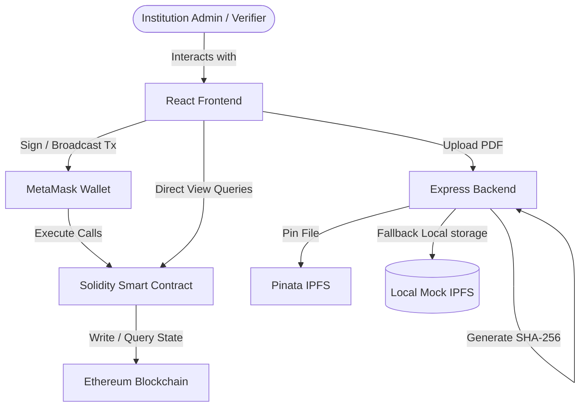
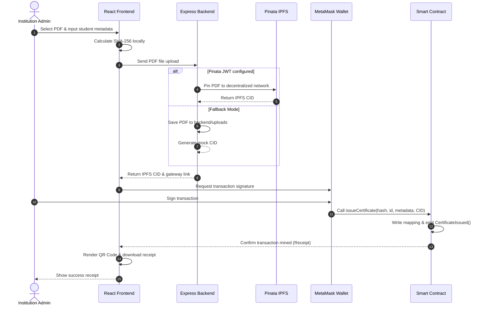
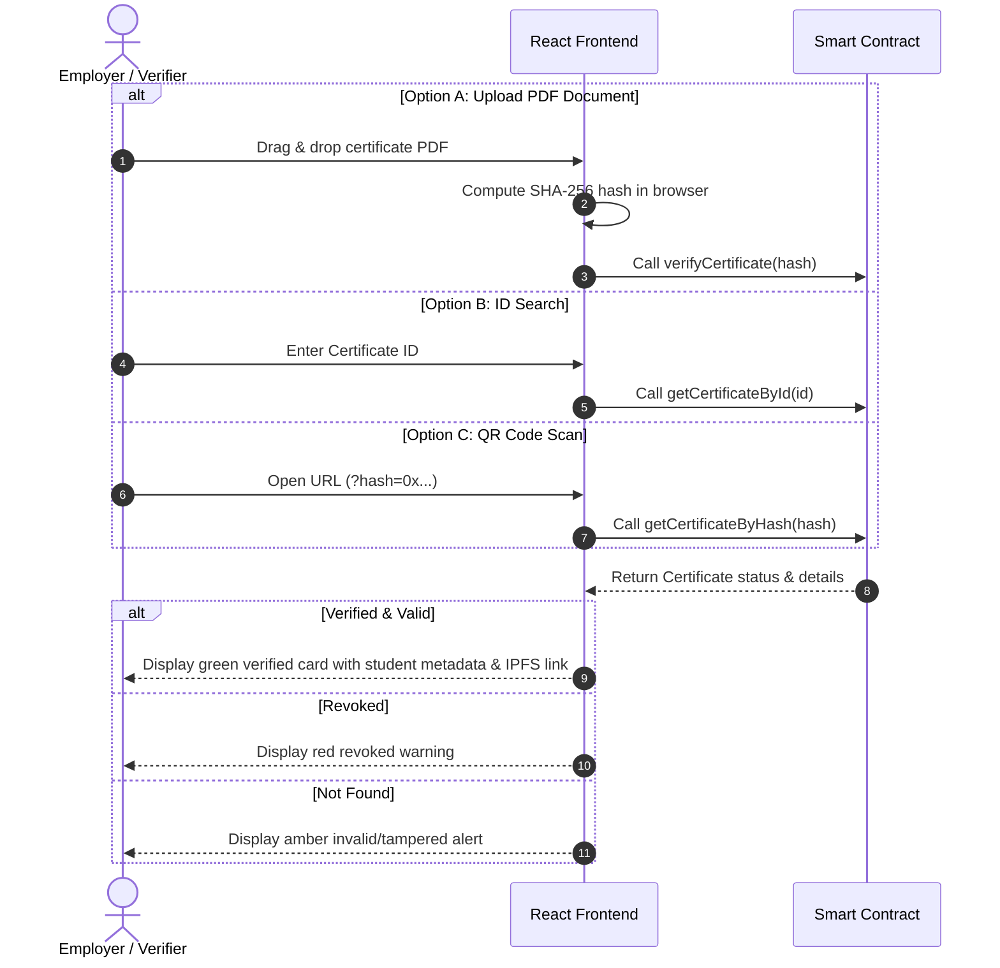

# Technical Documentation: Blockchain Certificate Verification System

This documentation provides an overview of the system architecture, smart contract design, workflow models, and deployment configurations of the **Blockchain Certificate Verification System**.

---

## 1. System Architecture

The application is structured as a full-stack Web3 decentralized application (dApp). It uses **Vite + React** for the UI, **Ethers.js v6** for smart contract connectivity, a **Node.js/Express** backend for document storage orchestration, and an **Ethereum Virtual Machine (EVM)** compatible blockchain network for storing certificate registries.



---

## 2. Smart Contract Design

The `CertificateRegistry` smart contract acts as the trust anchor. It uses SHA-256 hashes of the certificate PDFs as the unique primary identifier.

### Data Structure

```solidity
struct Certificate {
    string certificateId;      // Unique alphanumeric serial number
    string studentName;        // Name of the recipient
    string studentId;          // Academic identifier
    string institutionName;    // Issuing body name
    string certificateTitle;   // Degree/Certificate name (e.g., Bachelor of Arts)
    string course;             // Domain/Subject major
    string grade;              // Grade/CGPA achieved
    string ipfsCID;            // Decentralized storage pointer (CID)
    uint256 issueDate;         // Block timestamp of registration
    bool valid;                // Revocation indicator
    bool exists;               // Existence flag
}
```

### Storage Indexes
- `mapping(bytes32 => Certificate) public certificates;`
- `mapping(string => bytes32) public idToHash;`
- `mapping(address => bool) public admins;`

---

## 3. Workflow Diagrams

### Certificate Issuance Workflow



### Certificate Verification Workflow



---

## 4. API Specifications (Express Backend)

The Express backend serves as a utility node for processing documents. It does not carry any private keys or conduct on-chain transactions, ensuring a decentralized trust model.

### 1. Upload File & Generate Hash
- **Endpoint:** `POST /api/upload`
- **Payload:** `multipart/form-data` containing key `file` (PDF file).
- **Responses:**
  - `200 OK`: File processed successfully.
    ```json
    {
      "success": true,
      "fileName": "degree.pdf",
      "hash": "0x3f4f0d9a92ab...",
      "rawHash": "3f4f0d9a92ab...",
      "ipfsCID": "QmXoypi...",
      "ipfsUrl": "https://gateway.pinata.cloud/ipfs/QmXoypi...",
      "isMock": false
    }
    ```
  - `400 Bad Request`: Missing file payload.
  - `500 Internal Server Error`: Processing or storage upload error.

### 2. Retrieve Mock IPFS PDF
- **Endpoint:** `GET /api/ipfs/:cid`
- **Description:** Statically serves PDF files saved inside the mock storage directory.
- **Responses:**
  - `200 OK`: PDF file stream inline.
  - `404 Not Found`: CID not registered in local mock directory.

---

## 5. Security Architecture

1. **Immutable Hashes:** Documents are identified on-chain exclusively by their cryptographic SHA-256 signatures. If a single character or byte in the PDF is altered, the verification hash changes completely, prompting instant validation failure.
2. **Access Control:** The contract uses role-based access checks (`onlyAdmin` and `onlyOwner`). Only registered admin addresses added by the contract owner can sign transaction data to issue or revoke records.
3. **Decentralized Trust:** Verifiers interact directly with the blockchain contract using standard Ethereum providers. They do not rely on centralized API credentials, intermediate databases, or trusted middlemen to perform authenticity lookups.
